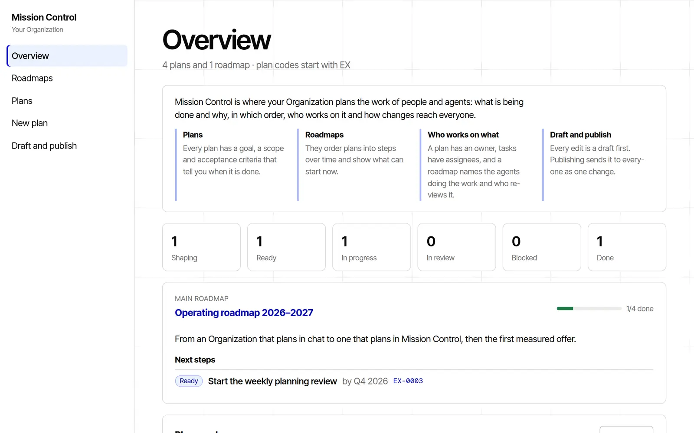

# Mission Control

Mission Control is where an Organization plans the work of its people and
agents together. A plan says what should change and why, for whom, and by
which acceptance criteria everyone knows it is done. Roadmaps order plans into
steps over time and show what can start now. Every plan has an owner, tasks
have assignees, and a roadmap names the agents doing its work and the people
who review it. Every edit is first a draft: a person reviews the changed
records in plain words and publishes them as one change, so colleagues and
agents always work from the same, current plan.



- **Plans** say why something is done, for whom, its scope, decisions and
  acceptance criteria. Each has a code with the Organization's prefix
  (`EX-0007`), an owner and proposed tasks with their assignees.
- **Roadmaps** order plans into steps over time, with priorities, the next
  steps that can start, the progress so far and who works on them. One
  roadmap can be the main one.
- **Draft & Publish**: an edit is a draft. A person reviews the changed
  records in business language and publishes them as one change to the
  Organization's data, or returns them.

The interface speaks Czech and English. It follows the language Lazurio
gives the page (the `locale` of `/.lazurio/shell.json`) and is Czech where
Lazurio says nothing; the records stay in whatever language the Organization
writes them. Mission Control is a Module of the
[Lazurio Module Standard](https://github.com/Lazurio/LazurioPlatform/blob/main/docs/module-standard.md)
and a template of the Lazurio Marketplace, published by LazurioTemplates as
the public upstream `LazurioTemplates/mission-control` under the MIT license.

## How it is built

| | |
| --- | --- |
| App generation | `app/v3`: data in [repository-db](https://github.com/Lazurio/repository-db) |
| Stack profile | [`app-data`](https://github.com/Lazurio/LazurioPlatform/blob/main/docs/stack-profiles.md#app-data), release 2026.11: Bun 1.4.4, TypeScript 7.0.2, Vite 8.3.5, React 19.3.1, Biome 2.6.4, Zod 4.6.7, `@lazurio/repository-db` v3.2.6, `@lazurio/module-kit` v0.2.0, exact versions only |
| Data | the Organization's own repository `mission-control-data`, branch `v3`, checked out as `db/` |
| Shape of the data | Zod schemas in `app/v3/src/domain/`; the JSON Schemas of the data repository are generated from them |

```text
app/v3/src/
  domain/   Zod schemas, rules across records and pure domain logic; knows no storage
  data/     the storage port (store.ts), its repository-db implementation and a memory one;
            files.ts reads and checks records for the App and the data repository alike
  i18n/     the Czech and English texts of the interface
  server/   Bun.serve: the HTTP API over the port, health, the client
  ui/       React; talks only to the HTTP API
  cli/      validate, schema and check bundle export
app/v3/tests/store-contract.ts   the shared test suite every store implementation passes
templates/data-repo/             the data repository an adopting Organization starts from
templates/sample-data/cs, /en    fictional example records (the "example plans" start)
```

The server never runs Git on the data and never reads a record file by a path
it built: every read and write goes through the storage port, which in `v3`
is repository-db's sync host. Generation `v4` (Dolt) replaces only that port
implementation; see [`docs/extending.md`](docs/extending.md).

## Run it

Lazurio starts the App from its Module manifest: `lazurio module start
<Organization>/mission-control`. To work on it in a worktree:

```bash
cd app/v3
bun install --frozen-lockfile
bun run check          # typecheck, Biome, generated schemas, seed validation, tests
LAZURIO_RUNTIME_LISTENER_WEB_HOST=127.0.0.1 LAZURIO_RUNTIME_LISTENER_WEB_PORT=<free port> bun run dev
```

`bun run dev` serves the data checkout `db/` at the Module root. Without one,
the App runs and says that the data is not available yet.

`bun run dev:demo` serves the fictional example records from memory instead:
nothing is read from or written to a repository, and every change is gone when
the process ends. `bun run dev:demo -- --locale en` serves the English example
records with the English interface. The Marketplace screenshots
(`docs/screenshots/cs/`, `docs/screenshots/en/`) come from it.

| Script | Does |
| --- | --- |
| `check` | the one gate: `typecheck`, `lint`, `schema:check`, `validate:seed`, `bun test` |
| `validate` | checks the data checkout `db/` (draft included) against the schemas and the rules across records; `-- --data <dir>` checks any directory laid out like a data repository |
| `schema:export` | regenerates `templates/data-repo/schemas/*.schema.json` and the data repository's check bundle `templates/data-repo/scripts/mission-control-check.js` |
| `build` | the client build of the built version (`dist/`) |

## Languages

Every text of the interface is in `app/v3/src/i18n/messages.ts`, once in
Czech and once in English; TypeScript holds both catalogs to the same shape,
so no screen can fall back to the other language. Codes, names and the
Organization's records are never translated. The App decides its language
once, before the first screen:

1. the `locale` of Lazurio's shell document `/.lazurio/shell.json` on the
   App's origin (contract `lazurio.shell.v1`), the language of the person's
   Environment;
2. otherwise the language the server was started with (`bun run dev:demo --
   --locale en`);
3. otherwise Czech.

Today Lazurio relays `/.lazurio/shell.json` only on the origins of its own
apps, not on a Module's
([LazurioPlatform#909](https://github.com/Lazurio/LazurioPlatform/issues/909),
[#135](https://github.com/Lazurio/LazurioPlatform/issues/135)): there the
App's own server answers 404 and Mission Control speaks Czech. It follows the
person's language without a new release once Lazurio relays the document.

The example records exist in both languages (`templates/sample-data/cs/`,
`templates/sample-data/en/`): the same codes, states, dates and people, so
the screenshots of both languages show the same views.

## Adopt it

The Marketplace in Lazurio hands an agent a brief; the agent follows
[`docs/adoption.md`](docs/adoption.md): it checks rights and name collisions,
creates a private Module with `lazurio module create`, merges the released
commit so it stays an ancestor, prepares the data repository and opens pull
requests. Nothing is merged or activated without the person's instruction.

## Documents

- [`AGENTS.md`](AGENTS.md): rules for agents working on this repository
- [`docs/adoption.md`](docs/adoption.md): taking the template into another Organization
- [`docs/extending.md`](docs/extending.md): changes within the generation, the
  move to `v4`, taking template updates, stack profile releases
- [`docs/data.md`](docs/data.md): the records, the data repository and its validator
- [`CHANGELOG.md`](CHANGELOG.md), [`SECURITY.md`](SECURITY.md), [`CONTRIBUTING.md`](CONTRIBUTING.md)

## License

MIT, see [`LICENSE`](LICENSE).
